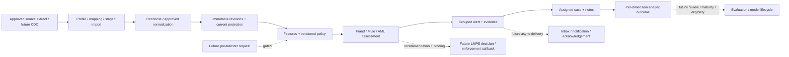

# LMPS Risk Portal — Trace โมดูล เมนู และขอบเขตที่พิสูจน์ได้จากแผน

วันที่วิเคราะห์: 23 ตุลาคม 2026  
ขอบเขตข้อมูล: `/Users/macbookpro/Documents/LMPS_Risk/plan` จำนวน 11 Markdown files (README + 01–10)  
วิธี: สำรวจโครงสร้างและค้น trace แบบ static จากเอกสารแผน แล้วอ่าน contracts/phase/status ที่เกี่ยวข้อง ไม่ได้เปิดบริการ ไม่ได้ตรวจ source code backend เพิ่ม และไม่ได้รันทดสอบระบบจริง

**ข้อสรุปหลัก:** ผลิตภัณฑ์เป็น Financial Crime Monitoring + Investigation Platform สำหรับ Fraud / Mule / AML แยกกัน มี local synthetic core เชื่อม policy → job → assessment → alert → case แล้วตามบันทึกล่าสุด แต่ real-source identity/semantics, online features/models, labels, push, pre-transfer enforcement และ production gates ยังไม่ผ่าน หน้า Portal และ routes ด้านล่างเป็นข้อเสนอออกแบบสำหรับ Figma Make ไม่ใช่รายการ routes ที่พบใน source router

## 1. หลักฐานและความเชื่อมั่น

- **Observed-document:** เอกสารระบุ feature/contract/status ตรง ๆ มีแหล่งบรรทัดกำกับ ความเชื่อมั่นสูงว่าเอกสารกล่าวเช่นนั้น
- **Reported-local:** เอกสารรายงานว่าทำและทดสอบ local/synthetic แล้ว ไม่ใช่เราได้รันทดสอบซ้ำหรือพิสูจน์ deployment
- **Proposed-UX:** ชื่อเมนู route grouping tab roles และหน้าจอที่แปลงจาก capability เพื่อทำ Portal
- **Unknown/gated:** สิ่งที่เอกสารยังไม่ยืนยัน; อย่าแสดงเป็น verified/healthy/live เพียงเพราะมีหน้าจอ mock

ใช้ skill reverse-engineer-anything ตามคำขอ โดยเลือก normal document/source tools สำหรับแผนที่มีให้อ่าน ไม่ต้องเปิด binary/REA engine เพราะไม่มี shipped executable เป็นเป้าหมาย การอ้าง E01–E25 ในรายงานนี้คือรหัสหลักฐานเอกสารที่สร้างเฉพาะรายงาน ไม่ใช่ REA execution Evidence IDs

### สถานะล่าสุดกับข้อความเก่าที่ขัดกัน

| ประเด็น | หลักฐานใหม่ที่ควรใช้ | ข้อความเก่าที่ไม่ควรตีความเป็นสถานะปัจจุบัน |
|---|---|---|
| Portal/Cases | No.37.1: Case backend local MVP; P06/S14 PARTIAL. No.33 เก็บ Portal code แต่เลื่อนงานหน้าจอ; browser acceptance ยังไม่สำเร็จ | ตาราง10 บรรทัด19 ยัง P06 NOT_STARTED; ไม่ควรสรุปว่าไม่มี backend Case แล้ว |
| Rule/risk/alert native acceptance | No.33 บรรทัด164–168 รายงาน native acceptance No.30–32 ผ่าน; core No.38.1 ผ่าน TCP integration | Header/ข้อความ No.30/31 ยังบอก native acceptance pending เป็นประวัติ ณ รอบนั้น |
| Project database | No.38.1 รายงาน project PG18503 ใช้15 migrations0000–0014 และ28 tables แล้ว | บันทึก No.30–37 ว่าไม่ migrate/seed project ถูกต้องเฉพาะ scope ในรอบนั้น |
| แพลตฟอร์มแอป | P07 และ README ใหม่: user-built Web App + Add to Home Screen | 01-tech-stack บรรทัด27 ยังแนะนำ React Native; ไม่ใช้เป็นข้อกำหนดล่าสุด |
| ความก้าวหน้า | หลังNo.38.1:28.25/104≈27.2% ตาม engineering rubric | 26.2% เป็น snapshot ถึงNo.34; ทั้งสองเลขไม่ใช่ production readiness |
| ข้อมูลจริง | เลือก manual export→Flash drive→offline import/reconcile ก่อนsync; ยังไม่มีไฟล์จริง/path/source configuration | ห้ามสมมติ CDC ใช้งานจริงหรือ current importer รองรับ2GB; limit64MiB/100000 rows ต่อไฟล์ |

หลักฐาน: E11, E19–E22, E24; ไม่แก้เอกสารต้นฉบับในงานนี้

## 2. โครงสร้าง logic เป้าหมายที่ต้องสะท้อนใน Portal

Diagram ต่อไปนี้เป็น target architecture หลังผ่าน gates ไม่ใช่ flow ของ Offline Replay ปัจจุบัน: raw staging/replay ยังไม่สร้าง canonical transactions หรือ operational alerts ส่วน local synthetic core มีเส้นทางแยกตาม No.38.1

แผนมี3เส้นทาง (E02): (1) pre-transfer decision ที่มีdeadline (2) continuous monitoringจากevents (3) investigation/feedback. ห้ามใช้CDCหลังโอนแทนการมีจุดholdก่อนโอน และห้ามให้ payment request รอpush provider

### Entities ที่ห้ามรวมเป็น record เดียว

| Entity | ความหมายและผลต่อหน้าจอ |
|---|---|
| Source change / observation | แถวต้นทาง/การเปลี่ยนพร้อมlineage ไม่ยืนยันว่าเป็นbusiness paymentใหม่ทุกครั้ง |
| Transaction event | เหตุการณ์ที่ผ่านsemantic mapping; source delete/history moveไม่ใช่reversalอัตโนมัติ |
| Current transaction projection | สถานะล่าสุดที่query; มีrevision historyแยก |
| Risk assessment | ผลหนึ่งrun ณ input/feature/policy version; immutable, rescoreสร้างrecordใหม่ |
| Alert | งานคัดกรองตามalert policy/dedup; ไม่เท่ากับทุกassessmentและไม่ใช่crime verdict |
| Case | หน่วยสอบสวนที่เชื่อมหลายalertsและevidence; มีassignment/version/state |
| Investigation outcome | ความเห็นแยกFraud/Mule/AMLพร้อมevidence/reviewer/version; current local unverified |
| Reviewed/mature label | ต้องผ่านadjudication/maturity/sampling; case closedไม่เท่ากับtraining eligible |
| Notification intent/attempt/ack | provider acceptance,opened,device receipt,user acknowledgementเป็นคนละstate |
| Decision / enforcement event | recommendationไม่ใช่หลักฐานว่าLMPSทำactionแล้ว |

หลักฐาน E04–E07, E12, E17, E21

## 3. Navigation ที่เสนอ

เมนูหลัก15หน้า แบ่ง6กลุ่ม ชื่ออังกฤษใช้ในmock UI และมีคำอธิบายไทยในเอกสาร; localeจริงตามแผนคือ **lo/en** ส่วน`la`เป็นcompatibility alias ของAPI ไม่ใช่localeหลัก ชื่อrouteทั้งหมดเป็นProposed-UX

| กลุ่ม | เมนู | Proposed route | วัตถุประสงค์ |
|---|---|---|---|
| Overview | Overview | `/overview` | ภาพรวมการเฝ้าระวัง |
| Monitoring | Transactions | `/transactions` | ธุรกรรมและประวัติการเปลี่ยนแปลง |
| Monitoring | Assessments | `/assessments` | ผลประเมินความเสี่ยงและหลักฐาน |
| Monitoring | Alerts | `/alerts` | กล่องงานแจ้งเตือนความเสี่ยง |
| Monitoring | Network Explorer | `/network` | เครือข่ายบัญชีและเส้นทางเงิน |
| Investigations | Cases | `/cases` | งานสอบสวนและมอบหมาย |
| Investigations | Outcomes & Label Review | `/outcomes` | ผลสอบสวนและการทบทวนป้ายกำกับ |
| Detection | Detector Catalog | `/detectors` | กฎและตัวตรวจจับความเสี่ยง |
| Detection | Risk Policies | `/policies` | เวอร์ชันนโยบายและการอนุมัติ |
| Detection | Evaluation & Models | `/models` | การประเมินและวงจรโมเดล |
| Data & Operations | Datasets & Imports | `/datasets` | ข้อมูลนำเข้าและการตรวจสอบความครบถ้วน |
| Data & Operations | Data & System Health | `/health` | สถานะข้อมูลและบริการ |
| Data & Operations | Notifications | `/notifications` | การส่งแจ้งเตือนและการรับทราบ |
| Data & Operations | Audit | `/audit` | ประวัติการเข้าถึงและการเปลี่ยนแปลง |
| Administration | Access & Scope | `/access` | สิทธิ์และขอบเขตการเข้าถึง |

โครงสร้างนี้ครอบคลุมเมนูที่P06ระบุตรง ๆ ได้แก่ Overview, Transactions, Alerts, Cases, Rules, Graph, Data/Model Health, Audit (E08) แล้วแยกAssessments,Policy,OutcomesและData importsเพื่อให้workflowที่เพิ่มล่าสุดหาเจอง่าย การเพิ่มหน้าเหล่านี้คือข้อเสนอUX; ไม่ได้หมายความว่ามีbusinessAPIครบแล้ว

ควรรวม `identity`, `institutions`, source adapters, vendor adapters, features, decisions และnotificationsเข้ากับหน้าที่เหมาะสม ไม่สร้างเมนูหลักตามทุกtable/service/package. PostgreSQL,Kafka,Flink,Valkey,Grafanaเป็นรายละเอียดhealth/diagnosticsตามสิทธิ์

## 4. รายละเอียดทุกเมนู

### 4.1 Overview — ภาพรวมการเฝ้าระวัง

**Route ที่เสนอ:** `/overview` · **Phase:** P06, P10  
**สถานะ backend ตามเอกสาร:** local synthetic data available in core; aggregate dashboard APIs not established  
**สถานะ UI:** เสนอออกแบบ; ยังไม่มีหลักฐานbrowser acceptanceจากการสำรวจครั้งนี้

**หน้ารอง / Tabs:** Risk overview · Operational readiness

**ข้อมูลหลัก:** 3 risk dimensions (separate); Alert workload; Case backlog; Data coverage; As-of/watermark; Source mode; Unavailable/degraded totals

**Filters:** Date/time range; Institution scope; Currency; Execution mode; Risk dimension

**Actions ที่ต้องออกแบบ:**

- Drill into filtered transaction/alert/case lists
- Refresh data
- Inspect coverage and freshness

**Persona/role ที่เสนอ:** analyst, supervisor, operator, auditor (ยังไม่ใช่ชื่อrole/scopeจริง)

**ขอบเขต logic และข้อจำกัด:**

- No invented production throughput, accuracy, loss prevented or 5M/day capacity KPI
- No sum of multiple currencies without approved FX
- 27.2% is engineering progress estimate, not readiness or risk score

**หลักฐาน:** E08, E12, E22, E23

### 4.2 Transactions — ธุรกรรมและประวัติการเปลี่ยนแปลง

**Route ที่เสนอ:** `/transactions` · **Phase:** P02, P03, P06  
**สถานะ backend ตามเอกสาร:** local synthetic revisions/read APIs and core demo reported; real canonical source mapping pending  
**สถานะ UI:** เสนอออกแบบ; ยังไม่มีหลักฐานbrowser acceptanceจากการสำรวจครั้งนี้

**หน้ารอง / Tabs:** All transactions · Transaction detail · Revision history · Source lineage

**ข้อมูลหลัก:** Opaque transaction/revision reference; Exact decimal amount + literal currency; Lifecycle + uncertainty; Event/observed/ingested times; Sender/receiver display attributes; Identity-resolution status; Source references; Linked assessments/alerts/cases

**Filters:** Bounded date; Institution; Currency; Product/channel; Lifecycle; Mode; Transaction reference

**Actions ที่ต้องออกแบบ:**

- Open detail
- Compare immutable revisions
- View assessment/evidence
- Bounded export (planned permission gate)

**Persona/role ที่เสนอ:** analyst, supervisor, auditor (ยังไม่ใช่ชื่อrole/scopeจริง)

**ขอบเขต logic และข้อจำกัด:**

- Detail route proposed /transactions/:id
- Source row ID is not account or business-payment identity
- Current projection and append-only events shown separately
- No unbounded browser dataset export

**หลักฐาน:** E03, E04, E06, E17, E22

### 4.3 Assessments — ผลประเมินความเสี่ยงและหลักฐาน

**Route ที่เสนอ:** `/assessments` · **Phase:** P05, P06, P09  
**สถานะ backend ตามเอกสาร:** local synthetic 15 detectors, frozen three-dimension scores and risk jobs; pre-transfer decisions not implemented  
**สถานะ UI:** เสนอออกแบบ; ยังไม่มีหลักฐานbrowser acceptanceจากการสำรวจครั้งนี้

**หน้ารอง / Tabs:** Assessment runs · Assessment detail · Evidence · Risk jobs · Decisions (future gated)

**ข้อมูลหลัก:** Fraud/Mule/AML value, scale, meaning, status; Coverage and missing prerequisites; Stable reason codes; Detector/rule/model/policy versions; Feature snapshot references; Input/revision hashes; Execution mode; Job attempts/checkpoints; Recommendation vs enforcement status (future)

**Filters:** Date; Institution; Dimension; Engine/policy version; Status; Mode; Job state

**Actions ที่ต้องออกแบบ:**

- Read immutable assessment
- Follow reason to evidence
- Inspect job attempts
- Rescore as new assessment (target design; no automatic enforcement)

**Persona/role ที่เสนอ:** analyst, supervisor, risk_author, operator, auditor (ยังไม่ใช่ชื่อrole/scopeจริง)

**ขอบเขต logic และข้อจำกัด:**

- Detail route proposed /assessments/:id; decision tab disabled with explicit integration prerequisite
- Missing=null/not_available, never zero risk
- 0–1 indices are not probabilities
- No live job enqueue/retry UI claimed: current job mutations are private CLI
- No automatic Hold/Block action in monitoring portal

**หลักฐาน:** E05, E06, E10, E19, E20, E22

### 4.4 Alerts — กล่องงานแจ้งเตือนความเสี่ยง

**Route ที่เสนอ:** `/alerts` · **Phase:** P05, P06  
**สถานะ backend ตามเอกสาร:** No.32 local grouped alert/review API and native acceptance No.33; real-source alert policies pending  
**สถานะ UI:** เสนอออกแบบ; ยังไม่มีหลักฐานbrowser acceptanceจากการสำรวจครั้งนี้

**หน้ารอง / Tabs:** Inbox · My alerts · Alert detail · History

**ข้อมูลหลัก:** Alert ID/severity/dimension; Assessment/policy references; State and revision; Assignee/owner; Created/age/as-of; Dedup group; Evidence summaries; Review opinion and reviewer; Linked case

**Filters:** Open/acknowledged/reviewed; Owner; Institution; Severity; Dimension; Policy; Date; Mode

**Actions ที่ต้องออกแบบ:**

- Acknowledge with explicit durable action
- Assign (target API; entitlement-aware)
- Read evidence
- Record suspicious/legitimate/unknown review
- Create/link case without auto-review

**Persona/role ที่เสนอ:** analyst, supervisor, auditor (ยังไม่ใช่ชื่อrole/scopeจริง)

**ขอบเขต logic และข้อจำกัด:**

- Detail route proposed /alerts/:id
- Local flow open→acknowledged→reviewed
- Alert review is unverified opinion, not mature training label
- Acknowledging alert does not close a case
- Case linking must respect unique ownership and revision conflicts

**หลักฐาน:** E06, E08, E19, E21

### 4.5 Network Explorer — เครือข่ายบัญชีและเส้นทางเงิน

**Route ที่เสนอ:** `/network` · **Phase:** P05, P06  
**สถานะ backend ตามเอกสาร:** bounded synthetic temporal graph/path prototype only; verified account identity and graph scale pending  
**สถานะ UI:** เสนอออกแบบ; ยังไม่มีหลักฐานbrowser acceptanceจากการสำรวจครั้งนี้

**หน้ารอง / Tabs:** Bounded network · Path evidence · Coverage

**ข้อมูลหลัก:** Entity type and resolution; Institution/routing role; Time-ordered edges; Amount/currency/lifecycle; Source and assessment references; Node/edge/time/hops limits; Truncation and unseen network disclaimer

**Filters:** Time range; Approved institution scope; Currency; Max hops; Node limit; Entity reference

**Actions ที่ต้องออกแบบ:**

- Expand bounded subgraph
- Select node/edge evidence
- Open linked transaction
- Reset graph

**Persona/role ที่เสนอ:** analyst_with_network_scope, supervisor_with_network_scope, auditor_with_network_scope (ยังไม่ใช่ชื่อrole/scopeจริง)

**ขอบเขต logic และข้อจำกัด:**

- No verified account graph from masked text/HMAC/transfer.id
- Partial/unresolved identity remains explicit; gate account graph/velocity when identity insufficient
- No assumption internal-bank or out-of-network transfers are visible
- No unbounded graph query; scope must be enforced by backend

**หลักฐาน:** E03, E05, E06, E08, E15

### 4.6 Cases — งานสอบสวนและมอบหมาย

**Route ที่เสนอ:** `/cases` · **Phase:** P06  
**สถานะ backend ตามเอกสาร:** No.37.1 backend local MVP; No.38.1 synthetic API case demo; case UI/attachments pending  
**สถานะ UI:** เสนอออกแบบ; ยังไม่มีหลักฐานbrowser acceptanceจากการสำรวจครั้งนี้

**หน้ารอง / Tabs:** All cases · Assigned to me · Case detail · Evidence · Notes · Outcomes · Timeline

**ข้อมูลหลัก:** Case ID/version/state; Assignee; Up to 20 linked alerts in local MVP; Frozen alert/assessment/policy/revision refs; Append-only notes/history; Per-dimension opinions; Actor and timestamps; Training eligible=false

**Filters:** Open/in_review/closed; Assignee; Institution/case scope; Updated date; Dimension

**Actions ที่ต้องออกแบบ:**

- Create case
- Link eligible alerts
- Assign
- Add note
- Start review
- Record separate dimension opinions
- Close after required outcomes
- Reopen with reason

**Persona/role ที่เสนอ:** case_creator, case_assigner, case_worker, case_reopener, evidence_reader (ยังไม่ใช่ชื่อrole/scopeจริง)

**ขอบเขต logic และข้อจำกัด:**

- Detail route proposed /cases/:id
- Actual scope names not supplied in plan; role labels above are proposed UX personas
- Case create/link,assign,work,reopen,evidence/audit permissions explicitly separated in plan
- Version CAS + idempotency; stale updates show conflict and preserve draft
- Changed assignment/evidence/reopen requires outcome re-evaluation; keep prior history
- Attachments and production SOP/directory/retention are pending; show disabled capability with explanation
- Case closed does not mean legitimate; case actions do not automatically acknowledge/review alert

**หลักฐาน:** E08, E21, E22

### 4.7 Outcomes & Label Review — ผลสอบสวนและการทบทวนป้ายกำกับ

**Route ที่เสนอ:** `/outcomes` · **Phase:** P06, P08  
**สถานะ backend ตามเอกสาร:** local per-dimension analyst opinions exist; adjudication/maturity/sampling/training export not implemented  
**สถานะ UI:** เสนอออกแบบ; ยังไม่มีหลักฐานbrowser acceptanceจากการสำรวจครั้งนี้

**หน้ารอง / Tabs:** Case outcomes · Review queue (planned) · Adjudication (planned) · Sampling & maturity (planned)

**ข้อมูลหลัก:** Dimension; Opinion/outcome code; Evidence; Reviewer; Confidence/uncertainty; Recorded/effective/mature-at time; Review status/version; Training eligibility; Sampling record

**Filters:** Dimension; Reviewer; Review status; Maturity; Institution; Case; Training eligibility

**Actions ที่ต้องออกแบบ:**

- Read opinion versions
- Follow case evidence
- Future authorized review/adjudicate
- Future controlled training export

**Persona/role ที่เสนอ:** case_worker, label_reviewer_proposed, model_governance_proposed, auditor (ยังไม่ใช่ชื่อrole/scopeจริง)

**ขอบเขต logic และข้อจำกัด:**

- Do not map local suspicious/legitimate opinions to confirmed_suspicious/confirmed_legitimate automatically
- All current case outcomes analyst_reviewed/unverified, training_eligible=false
- Unknown/not reviewed/no alert/case closed never auto-negative
- No training export button enabled merely because case is closed

**หลักฐาน:** E08, E12, E21

### 4.8 Detector Catalog — กฎและตัวตรวจจับความเสี่ยง

**Route ที่เสนอ:** `/detectors` · **Phase:** P05, P06  
**สถานะ backend ตามเอกสาร:** 15 bilingual synthetic detector definitions and basic immutable amount-rule versions reported  
**สถานะ UI:** เสนอออกแบบ; ยังไม่มีหลักฐานbrowser acceptanceจากการสำรวจครั้งนี้

**หน้ารอง / Tabs:** Detector catalog · Detector detail · Rule versions · Backtests

**ข้อมูลหลัก:** Fraud/Mule/AML family; Stable detector/reason code; Lao/English definitions; Prerequisites/limitations; Typed condition parameters; Rule version/hash; Owner; Dataset/feature version; Backtest coverage/unavailable counts

**Filters:** Family; Prerequisite available; Version; Language; Status

**Actions ที่ต้องออกแบบ:**

- Read definitions/conditions/evidence
- Compare versions
- Draft typed rule version (target)
- Run bounded offline backtest (target UI)

**Persona/role ที่เสนอ:** analyst, risk_author, risk_approver, auditor (ยังไม่ใช่ชื่อrole/scopeจริง)

**ขอบเขต logic และข้อจำกัด:**

- Plan states total15 detectors but does not enumerate all detector IDs; do not invent authoritative detector names
- Restricted typed DSL only; no JavaScript/Python/arbitrary SQL editor
- Backtest has no live alerts, push or money effects
- Rule approval/production effective-date lifecycle is distinct from implemented local policy lifecycle

**หลักฐาน:** E01, E05, E06, E08, E19

### 4.9 Risk Policies — เวอร์ชันนโยบายและการอนุมัติ

**Route ที่เสนอ:** `/policies` · **Phase:** P05, P06, P09  
**สถานะ backend ตามเอกสาร:** No.36.1 local immutable policy lifecycle, comparison, generation CAS activation/rollback; production governance pending  
**สถานะ UI:** เสนอออกแบบ; ยังไม่มีหลักฐานbrowser acceptanceจากการสำรวจครั้งนี้

**หน้ารอง / Tabs:** Policy versions · Draft/submitted · Approvals · Comparison · Activation history

**ข้อมูลหลัก:** Policy ID/hash/version; Namespace/currency scope; Creator/submitter/approver; Draft/submitted/approved/rejected; Generation; Activation binding/receipt; Frozen comparison run refs; Thresholds and coverage changes

**Filters:** Status; Namespace; Currency; Creator; Approver; Version; Date

**Actions ที่ต้องออกแบบ:**

- Create draft
- Submit
- Approve/reject by independent actor
- Compare 1–20 frozen synthetic runs
- Activate/rollback local namespace binding with expected generation
- Inspect job selection receipt

**Persona/role ที่เสนอ:** risk_author, risk_approver, policy_activator_proposed, auditor (ยังไม่ใช่ชื่อrole/scopeจริง)

**ขอบเขต logic และข้อจำกัด:**

- Creator/submitter cannot approve own policy
- Activation is local policy selection binding; does not activate live payment enforcement
- Comparison advisory, not mandatory approval attestation in local MVP
- Already accepted jobs keep frozen approved policy/hash/receipt after activation changes
- Do not imply effective-dated production rollout exists

**หลักฐาน:** E05, E06, E13, E21

### 4.10 Evaluation & Models — การประเมินและวงจรโมเดล

**Route ที่เสนอ:** `/models` · **Phase:** P08  
**สถานะ backend ตามเอกสาร:** target design; FastAPI diagnostics only; no trained production model/evaluation acceptance  
**สถานะ UI:** เสนอออกแบบ; ยังไม่มีหลักฐานbrowser acceptanceจากการสำรวจครั้งนี้

**หน้ารอง / Tabs:** Evaluation runs · Dataset manifests · Model registry · Model health · Deployments (planned)

**ข้อมูลหลัก:** Dataset/split/code/model/policy versions; Temporal availability grade; Label maturity/coverage; Fraud/Mule/AML metrics separately; Operating alert capacity; Confidence/uncertainty; Serving model/signature/readiness; Pinned deployment/version history

**Filters:** Dimension; Cohort; Institution/product/currency; Model version; Dataset; Evaluation mode

**Actions ที่ต้องออกแบบ:**

- Inspect reproducible evaluation report
- Compare candidates on same cohort
- Read model card
- Future approve/deploy/rollback after governance

**Persona/role ที่เสนอ:** model_engineer_proposed, model_governance_proposed, operator, auditor (ยังไม่ใช่ชื่อrole/scopeจริง)

**ขอบเขต logic และข้อจำกัด:**

- Unavailable metrics shown as N/A + reason; no invented accuracy95%
- Synthetic labels test plumbing only
- Rules/anomaly/graph can be developed without supervised labels
- No claim SQL/Python graph or MLflow is deployed merely because recommended
- External vendor/GNN/GPU conditional, no top-level vendor shopping menu

**หลักฐาน:** E09, E12, E15

### 4.11 Datasets & Imports — ข้อมูลนำเข้าและการตรวจสอบความครบถ้วน

**Route ที่เสนอ:** `/datasets` · **Phase:** P01, P03  
**สถานะ backend ตามเอกสาร:** No.35.1 profiler,35.2 staging import/reconcile,35.3 threshold simulation replay local CLI reported  
**สถานะ UI:** เสนอออกแบบ; ยังไม่มีหลักฐานbrowser acceptanceจากการสำรวจครั้งนี้

**หน้ารอง / Tabs:** Batches · Profile & mapping · Import checkpoints · Reconciliation · Offline replay

**ข้อมูลหลัก:** Batch/manifest/hash; Candidate source table; Count/size limits; Quality unknowns; Draft mapping version; Checkpoint/attempt/resume state; Exact currency totals; Duplicate/conflict counts; Simulation policy/report refs; Privacy/access class

**Filters:** Batch; Table; Stage; Status; Date; Currency

**Actions ที่ต้องออกแบบ:**

- Inspect profile/manifest
- Inspect staged import checkpoints
- Compare reconciliation
- Read offline simulation results
- Future approved upload/import controls after API contract

**Persona/role ที่เสนอ:** data_operator_proposed, data_owner_proposed, auditor (ยังไม่ใช่ชื่อrole/scopeจริง)

**ขอบเขต logic และข้อจำกัด:**

- Current interface is CLI, not proven browser upload/import API
- Current local per-file limit64MiB and100000 records; approximately2GB export not supported as a single file
- User chose manual export→Flash drive→offline import/reconcile before sync; actual source/export path not supplied
- Staging raw rows are not canonical transactions; API/app/reviewer/outbox cannot read raw staging
- Offline raw-amount threshold replay is simulation; it creates no operational alert/account/graph

**หลักฐาน:** E03, E20, E22, E25

### 4.12 Data & System Health — สถานะข้อมูลและบริการ

**Route ที่เสนอ:** `/health` · **Phase:** P02, P03, P04, P10  
**สถานะ backend ตามเอกสาร:** local operations/diagnostics/sync states and backup restore reported; real CDC/stream/model and production SLO pending  
**สถานะ UI:** เสนอออกแบบ; ยังไม่มีหลักฐานbrowser acceptanceจากการสำรวจครั้งนี้

**หน้ารอง / Tabs:** Service health · Data quality & coverage · Source/sync status · Features · Risk jobs · Outbox · Recovery & readiness

**ข้อมูลหลัก:** Liveness vs readiness; As-of/freshness/watermarks; Unresolved/invalid/late/quarantined counts; Import vs reconciliation state; Job/lease/attempt state; Source vs downstream lag; Feature coverage/version; Backup/restore evidence refs; Gate owner/status

**Filters:** Workspace/institution as authorized; Service; Pipeline stage; Date; Mode

**Actions ที่ต้องออกแบบ:**

- Refresh/inspect failure details
- Read correlation reference
- Open runbook/evidence
- Inspect gated recovery status

**Persona/role ที่เสนอ:** operator, data_operator_proposed, auditor (ยังไม่ใช่ชื่อrole/scopeจริง)

**ขอบเขต logic และข้อจำกัด:**

- No connection secrets/config editor or production start/stop controls invented
- Null replica lag is unknown, not zero
- Readiness green does not prove real source/models/production readiness
- Kafka/Flink/Valkey/PostgreSQL are status drilldowns; not separate main nav modules
- 5M/day remains capacity target pending measured end-to-end gate

**หลักฐาน:** E16, E18, E20, E22, E25

### 4.13 Notifications — การส่งแจ้งเตือนและการรับทราบ

**Route ที่เสนอ:** `/notifications` · **Phase:** P02, P07  
**สถานะ backend ตามเอกสาร:** fake transactional outbox local foundation only; actual Web App delivery/subscription/push acceptance pending  
**สถานะ UI:** เสนอออกแบบ; ยังไม่มีหลักฐานbrowser acceptanceจากการสำรวจครั้งนี้

**หน้ารอง / Tabs:** Outbox intents · Attempts · Acknowledgements · Escalation · Subscriptions (planned)

**ข้อมูลหลัก:** Opaque intent/alert reference; Recipient scope; Channel/mode/policy; Queued/processing/provider_accepted/retry_scheduled/failed/expired/cancelled; Attempt lease/retry/TTL; Opened/device receipt/ack distinct; Escalation target/time

**Filters:** State; Channel; Mode; Institution; Date; Alert reference

**Actions ที่ต้องออกแบบ:**

- Inspect attempt history
- Follow authorized alert
- Future revoke owned subscription
- Future controlled retry/cancel per contract

**Persona/role ที่เสนอ:** operator, supervisor, auditor (ยังไม่ใช่ชื่อrole/scopeจริง)

**ขอบเขต logic และข้อจำกัด:**

- Do not present provider_accepted as delivered/seen/acknowledged
- No real send/test-push button enabled by default
- Staff recipients are candidate; not assumed account holders
- No account/name/amount/raw evidence on lock screen
- Web App/Add to Home Screen selected; offline/service worker/push not thereby implemented
- Alert remains in inbox when notification denied/offline/expired

**หลักฐาน:** E07, E09, E18

### 4.14 Audit — ประวัติการเข้าถึงและการเปลี่ยนแปลง

**Route ที่เสนอ:** `/audit` · **Phase:** P02, P06, P10  
**สถานะ backend ตามเอกสาร:** local protected database-trigger/service audit and scoped read APIs; admin-resistant archive/WORM not established  
**สถานะ UI:** เสนอออกแบบ; ยังไม่มีหลักฐานbrowser acceptanceจากการสำรวจครั้งนี้

**หน้ารอง / Tabs:** Audit events · Event detail · Access & export history (target)

**ข้อมูลหลัก:** Actor type/reference; Action/target; Expected/actual revision; Reason; Time/correlation; Scope/mode; Prior/new state references; Protected archive evidence

**Filters:** Date; Actor type; Action; Target; Institution/case scope; Correlation

**Actions ที่ต้องออกแบบ:**

- Read event
- Navigate to authorized object/version
- Bounded redacted export (planned controls)

**Persona/role ที่เสนอ:** auditor, security_operator_proposed, case_evidence_reader (ยังไม่ใช่ชื่อrole/scopeจริง)

**ขอบเขต logic และข้อจำกัด:**

- Database session-role actor is not employee identity by default; newer case actor from JWT shown explicitly
- No edit/delete audit controls
- Application append-only is not immutable to DBA
- Raw payload/credentials/PII never included merely for debugging

**หลักฐาน:** E06, E13, E17, E21, E22

### 4.15 Access & Scope — สิทธิ์และขอบเขตการเข้าถึง

**Route ที่เสนอ:** `/access` · **Phase:** P02, P06, P10  
**สถานะ backend ตามเอกสาร:** local synthetic JWT/scoped authorization; production IdP/entitlements/revocation and directory pending  
**สถานะ UI:** เสนอออกแบบ; ยังไม่มีหลักฐานbrowser acceptanceจากการสำรวจครั้งนี้

**หน้ารอง / Tabs:** My access · Role/scope matrix (proposed) · Institution mapping (proposed) · Readiness prerequisites

**ข้อมูลหลัก:** Authenticated actor; Current institution/case/network scope; Action capabilities; Session state; Identity provider status; Directory evidence; Routing vs owning institution distinction

**Filters:** Role/persona; Institution; Capability; Pending prerequisite

**Actions ที่ต้องออกแบบ:**

- Read own scope
- Inspect role matrix
- Future approved IdP-managed entitlement changes

**Persona/role ที่เสนอ:** access_admin_proposed, security_operator_proposed, auditor (ยังไม่ใช่ชื่อrole/scopeจริง)

**ขอบเขต logic และข้อจำกัด:**

- Role names/personas proposed, not actual entitlement literals
- Never grant network-wide data because sidebar shows all institutions
- Actor/scope from authenticated server context, never body override
- Route guard and hidden button are UX, backend authorization still required
- No create-user/reset-password capability assumed because local JWT exists

**หลักฐาน:** E03, E13, E15, E18, E21

## 5. ลำดับ interaction ที่ต้องทำให้เข้าใจได้ใน Figma Make

1. **Transaction → Assessment:** คลิกแถวtransactionเห็นcurrent revisionและhistory; ไปassessmentเห็นscoresสามdimensionแยก ไม่ทำone-numberriskโดยไม่มีapproved aggregation. Reasonแสดงfeaturesที่ใช้จริง,missing prerequisites,versionsและas-of
2. **Alert → Case:** เปิดalertอ่านevidenceแล้วacknowledgeเป็นactionแยก; create/linkcaseตรวจscope/uniqueownership. ไม่อ้างว่าลิงก์caseเท่ากับreviewalertแล้ว
3. **Case investigation:** case open→in_review→closed; reopenรักษาประวัติ. ข้อมูลที่เปลี่ยนอย่างassignment/evidence/reopenทำให้outcomesต้องประเมินใหม่ตามbackendcontract. Localcaseรองรับ20alertsสูงสุด; ออกแบบlimit/reasonไม่ปล่อยให้ผู้ใช้เพิ่มแล้วหายเงียบ
4. **Outcome:** บันทึกFraud/Mule/AMLแยก,unknownถูกต้องได้. หลังปิดcaseยังแสดงunverified/training_eligible=false. Labelreview/adjudicationเป็นfuturegate ไม่ใช่ปุ่ม“ส่งtrain”ทันที
5. **Policy:** draft→submitted→approved/rejected,approveโดยคนละactor. Localactivation/rollbackเลือกnamespace+currencyและexpectedgeneration. Comparison1–20runsเป็นadvisory; ยอมรับjobแล้วเก็บfrozenpolicyต่อแม้activationเปลี่ยน
6. **Dataset:** profile→draftmapping→stagingimport/checkpoints→reconcile→offlinethresholdsimulation. ทุกหน้าระบุStaging/Simulationชัดเจน; ไม่แสดงเป็นcanonicalriskหรือoperationalalert. UploadAPIยังไม่พบในplan; ทำเป็นdisabledfutureflowหรือmockที่ติดlabelชัด
7. **Notification:** outboxqueued→processing→provider_accepted/retry/failed/expired/cancelled;openedและackไม่ใช้แทนกัน. Fake/Sandboxเท่านั้นในprototype;ไม่มีproductionpushโดยอนุมาน
8. **Conflict:** เมื่อexpectedrevision/generationเก่า ให้บอก“ข้อมูลเปลี่ยนแล้ว”พร้อมreload/compareและรักษาdraft;ไม่overwriteเงียบ. Retrypayloadเดิมต้องไม่สร้างduplicate
9. **Pre-transfer:** futuredecisiontabแสดงprerequisitesและscope;recommendationแยกactualenforcement. ไม่สร้างปุ่มHold/Blockที่ดูใช้เงินจริงได้ในmonitorprototype

## 6. Shared product rules และ states

- แสดงpersistent **Synthetic/Demo** กับinstitution/case scope,as-of,freshness/coverage;mockตัวเลขทุกตัวติดsyntheticหรือdemo. ข้อมูลจริงที่ไม่ยืนยันใช้N/A/unknownพร้อมเหตุผล
- มีloading,empty,error,stale,partial,permission-denied,not-implemented,unavailable,conflict;emptyไม่ใช่ระบบเสียและunknownไม่เท่ากับsafe
- ช่วงเวลาdisplayเสนอAsia/Vientianeแต่source timezoneยังไม่ยืนยัน;เก็บoriginaltime/uncertaintyไม่แปลงnaivetimeเป็นUTCเงียบ
- Moneyเป็นdecimalstringพร้อมcurrency;IDsเป็นstring;ไม่ใช้JSfloatกับexactmoney ไม่บวกLAK/THB/USDเป็นยอดเดียว
- ใช้boundeddate/servercursor/filter;graphจำกัดhops/nodes/timeและแสดงtruncation;exportมีpermission/redaction/limits ไม่ส่งdatasetทั้งหมดผ่านbrowser
- Scoresมีvalue/scale/meaning/status/engine/calibrationref. Localindex0–1ไม่ใช่probability;missing=null ไม่เติม0. Severityขึ้นกับpolicyversionไม่ใช่threshold80สากล
- ระบุidentity resolved/partial/unresolved/invalid;maskedstring,HMACของmaskedstringและtransactionrowIDไม่ใช่verifiedaccountkey
- Session/actor/scopeมาจากserver;UIhide/routeguardช่วยUXเท่านั้น. Institution/routingmember/accountownerเป็นคนละconcept
- ไม่มีsecrets/rawPIIในlogs,push,exportหรือauditdetailที่ไม่ผ่านสิทธิ์

หลักฐาน E03–E07,E12–E18,E21–E25

## 7. Permission design ที่เสนอและสิ่งที่ยืนยันได้

**สิ่งที่แผนระบุตรง:** server-sideinstitution/case/networkscope;network-widepermissionเฉพาะ;maker/checker;actorจากJWT;casecreate/link,assign,work,reopen,evidence/auditแยกscope;appอ่านอย่างเดียวในหลายstoragepaths

**สิ่งที่เป็นข้อเสนอUX:** Analyst, Supervisor, Risk Author, Risk Approver, Data Operator, Operations, Model Governance, Auditor, Access Admin และชื่อในJSON. ยังไม่มีapprovedcorporateIdP/roleclaims/entitlementdirectoryครบ จึงห้ามนำlabelเหล่านี้ไปอ้างว่าเป็นpermissionliteralจริง

| Persona เสนอ | อ่าน | ทำงาน | ข้อจำกัดสำคัญ |
|---|---|---|---|
| Analyst / Case worker | Transactions,assessments,alerts,casesในscope | Ack,notes,outcomes;create/linkเมื่อมีpermissionแยก | ไม่มีnetwork-wideโดยdefault;ไม่มีpolicyapprove |
| Supervisor / Case assigner | Queue/workload/caseในscope | Assign,reopenตามpermission | Caseassign/reopenไม่รวมในroleทุกคนโดยอัตโนมัติ |
| Risk Author | Detectors,rule/policy versions,comparison | Draft/submit | Approveของตัวเองไม่ได้ |
| Risk Approver | Submittedpolicy+evidence | Approve/reject | เป็นindependentactor;activateอาจต้องpermissionอีกชุด |
| Data Operator | Import/profile/reconcile/health | CurrentCLIops;futureUIตามapprovedAPI | ไม่มีrawstagingbrowseraccess/real-sourceconnectโดยอนุมาน |
| Operations | Health,jobs,outbox,recoveryevidence | Futureoperationscontrolsตามcontract | ไม่ได้รับsensitivebankdataเพียงเพราะดูservicehealth |
| Model Governance | Dataset/labels/evaluations/cards | Futureapprove/deployตามgates | ไม่มีtrainingถ้าlabelsไม่eligible |
| Auditor | Authorizedaudit/history/evidence | Read/boundedexportตามpermission | ไม่มีeditauditหรือยกระดับcross-institutionscope |

## 8. ขอบเขตที่ควรให้ Figma Make ทำก่อน

- **Core working mock:** shell+overview,transactionlist/detail,assessmentdetail,alertinbox/detail,caseworkspace,policylist/independentapprovaldialog,healthreadiness. ใช้coherentlocalfixtureIDsเชื่อมทุกหน้า
- **Secondary mock:** datasets/reconcile/replay,catalog,notificationsattempts,audit,accessmatrix. ทุกmutationที่ยังเป็นCLIหรือplannedAPIติดsimulation/preview
- **Gated future surfaces:** verifiednetwork,labels/adjudication,evaluation/models,actualnotification delivery,pre-transferdecisions. ทำหน้าเปล่าที่มีprerequisiteและตัวอย่างที่ระบุsyntheticได้ แต่อย่าโชว์healthy/liveโดยไม่มีหลักฐาน
- ขอบเขตนี้คือข้อเสนอการออกแบบprompt;ไม่เปลี่ยนarchitecture,backend,productionconfigหรือข้อมูลต้นฉบับ

## 9. Finding ledger / Checklist

| คำถามจากโจทย์ | ผล | Evidence type / boundary | สิ่งที่ยังไม่ทราบ |
|---|---|---|---|
| มีโมดูลธุรกิจอะไรบ้าง | Answeredจาก11เอกสาร: identity/source/transactions/features/rules/assessments/decisions/alerts/cases/outcomes/notifications/audit/vendor+evaluation | Observed-document E01–E25 | Runtimecoverageและexactsourcecodeimplementationไม่ได้ตรวจ |
| Portalควรมีเมนูไหน | Answeredเป็นproposed15primaryroutes+tabs | ExplicitP06domains E08 + Proposed-UX | ไม่มีauthoritativefrontendrouterในscopeplan |
| Backendทำอะไรแล้ว | AnsweredเฉพาะreportedlocalถึงNo.38.1 | E19–E22;notrerun | Production,sourceจริง,UIbrowseracceptance |
| Logicเชื่อมกันอย่างไร | Answeredตามcontracts+latestlocaldemo | E02,E04–E10,E20–E22 | ActualLMPSintegration/sourceidentityยังgated |
| Roles/permissionsจริง | Partiallyanswered | RequirementsตรงE13/E21;personasproposed | ApprovedIdPclaims,roleliteral,directory,networkauthority |
| รายชื่อ15detectorsทั้งหมด | Unresolvedในขอบเขตplanที่อ่าน | Planยืนยันcount/familiesE19 แต่ไม่enumerate15ID | ต้องตรวจpackages/riskcatalogถ้าจะtracecodeเพิ่ม |
| Productionreadiness | Explicitlypending | E14,E18,E22 | Namedowners/signoffs/data/security/ops/enforcementgates |

## 10. Evidence register

เส้นทางsourceทั้งหมดอยู่ในplanที่ผู้ใช้ให้และไม่ถูกแก้ไข line rangesสำหรับตรวจต่อจากsnapshotวันที่วิเคราะห์;ลิงก์เปิดที่บรรทัดเริ่ม

| ID | Source / lines | รองรับข้อสรุป |
|---|---|---|
| E01 | [01-tech-stack-and-cost.md](/Users/macbookpro/Documents/LMPS_Risk/plan/01-tech-stack-and-cost.md:18) · L18–L84 | Frontend baseline, 14 backend responsibilities, API/worker boundaries |
| E02 | [02-architecture-data-and-api.md](/Users/macbookpro/Documents/LMPS_Risk/plan/02-architecture-data-and-api.md:15) · L15–L66 | Three logical paths: pre-transfer, continuous monitoring, investigation/feedback |
| E03 | [02-architecture-data-and-api.md](/Users/macbookpro/Documents/LMPS_Risk/plan/02-architecture-data-and-api.md:70) · L70–L135 | Source candidates, identity unresolved, privacy zones |
| E04 | [02-architecture-data-and-api.md](/Users/macbookpro/Documents/LMPS_Risk/plan/02-architecture-data-and-api.md:137) · L137–L182 | Transaction/event/assessment/alert/case/outcome distinctions; mode/replay isolation |
| E05 | [02-architecture-data-and-api.md](/Users/macbookpro/Documents/LMPS_Risk/plan/02-architecture-data-and-api.md:223) · L223–L292 | Feature contracts, domain data model, score semantics and immutable assessments |
| E06 | [02-architecture-data-and-api.md](/Users/macbookpro/Documents/LMPS_Risk/plan/02-architecture-data-and-api.md:294) · L294–L348 | Proposed API surface; idempotency; decision/payment binding |
| E07 | [02-architecture-data-and-api.md](/Users/macbookpro/Documents/LMPS_Risk/plan/02-architecture-data-and-api.md:350) · L350–L377 | Notification outbox/attempt/acceptance/device/ack contracts |
| E08 | [03-implementation-phases.md](/Users/macbookpro/Documents/LMPS_Risk/plan/03-implementation-phases.md:173) · L173–L225 | P05 detection and P06 explicit portal menus, UI states, case/label workflow |
| E09 | [03-implementation-phases.md](/Users/macbookpro/Documents/LMPS_Risk/plan/03-implementation-phases.md:227) · L227–L283 | P07 user-built Web App and P08 evaluation/model requirements |
| E10 | [03-implementation-phases.md](/Users/macbookpro/Documents/LMPS_Risk/plan/03-implementation-phases.md:285) · L285–L311 | P09 decision engine, authority and enforcement gates |
| E11 | [04-code-session-backlog.md](/Users/macbookpro/Documents/LMPS_Risk/plan/04-code-session-backlog.md:1) · L1–L17 | Newest progress summary and portal code partial status |
| E12 | [05-evaluation-security-deployment.md](/Users/macbookpro/Documents/LMPS_Risk/plan/05-evaluation-security-deployment.md:9) · L9–L72 | Outcome definitions, label quality, evaluation coverage and honest metrics |
| E13 | [05-evaluation-security-deployment.md](/Users/macbookpro/Documents/LMPS_Risk/plan/05-evaluation-security-deployment.md:115) · L115–L158 | Authentication, scope, audit, secrets, failure states |
| E14 | [05-evaluation-security-deployment.md](/Users/macbookpro/Documents/LMPS_Risk/plan/05-evaluation-security-deployment.md:252) · L252–L272 | Scope-specific production gates and stop/rollback conditions |
| E15 | [06-decisions-and-references.md](/Users/macbookpro/Documents/LMPS_Risk/plan/06-decisions-and-references.md:61) · L61–L115 | Open decisions O-001–O-017; account-identity unresolved; adoption gates |
| E16 | [07-mariadb-replica-bootstrap.md](/Users/macbookpro/Documents/LMPS_Risk/plan/07-mariadb-replica-bootstrap.md:144) · L144–L181 | Replica monitoring, lag/coverage, source impact and missing setup inputs |
| E17 | [08-postgresql-enterprise-design.md](/Users/macbookpro/Documents/LMPS_Risk/plan/08-postgresql-enterprise-design.md:75) · L75–L99 | Target logical model for current state/history/evidence |
| E18 | [09-missing-inputs-and-foundation-readiness.md](/Users/macbookpro/Documents/LMPS_Risk/plan/09-missing-inputs-and-foundation-readiness.md:21) · L21–L54 | Owners/SLO and source, identity, auth, labels, storage, product unknowns |
| E19 | [10-next-implementation-steps.md](/Users/macbookpro/Documents/LMPS_Risk/plan/10-next-implementation-steps.md:132) · L132–L168 | No.30–32 synthetic rules/risk/alerts, No.33 native acceptance; portal work deferred |
| E20 | [10-next-implementation-steps.md](/Users/macbookpro/Documents/LMPS_Risk/plan/10-next-implementation-steps.md:171) · L171–L199 | No.34 jobs and No.35.1–35.3 dataset profile/import/replay capabilities and limits |
| E21 | [10-next-implementation-steps.md](/Users/macbookpro/Documents/LMPS_Risk/plan/10-next-implementation-steps.md:202) · L202–L216 | No.36.1 policy governance and No.37.1 cases backend local MVP |
| E22 | [10-next-implementation-steps.md](/Users/macbookpro/Documents/LMPS_Risk/plan/10-next-implementation-steps.md:218) · L218–L231 | No.38.1 current local core demo, manual export direction and revised progress |
| E23 | [README.md](/Users/macbookpro/Documents/LMPS_Risk/plan/README.md:29) · L29–L46 | Confirmed business scope: fraud/mule/AML, alerts, cases, decisions, evaluation, audit |
| E24 | [README.md](/Users/macbookpro/Documents/LMPS_Risk/plan/README.md:72) · L72–L129 | Current architecture, Web App direction and enforcement gate |
| E25 | [03-implementation-phases.md](/Users/macbookpro/Documents/LMPS_Risk/plan/03-implementation-phases.md:87) · L87–L171 | P02 auth/API/audit/outbox; P03 ingestion/reconciliation; P04 feature health |
