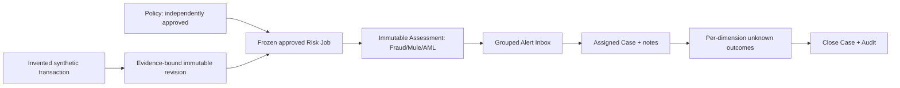
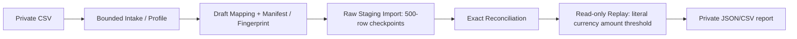
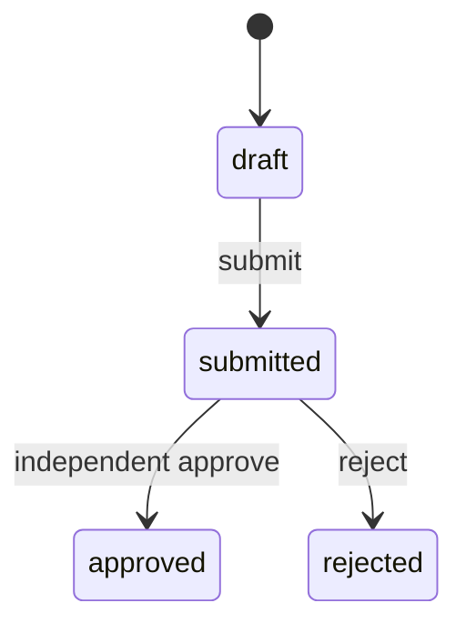
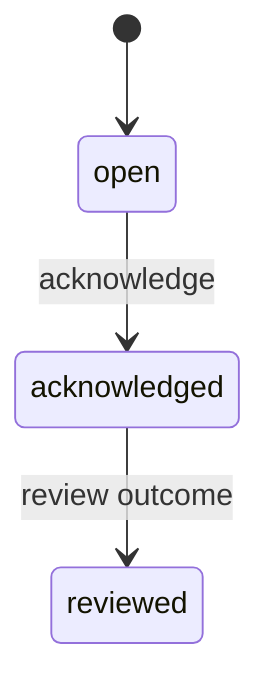
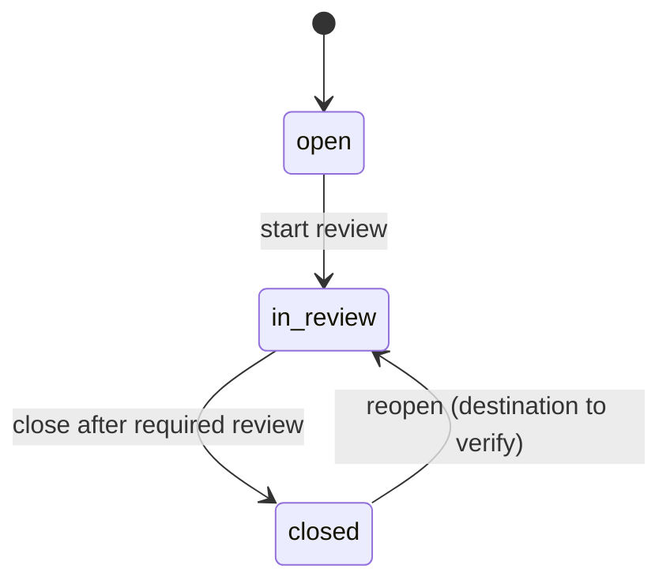

# LMPS Risk — Business Logic, Data Flow และ Workflow สำหรับ Portal

วันที่วิเคราะห์: 23 ตุลาคม 2026 • ขอบเขตหลักฐาน: เอกสาร Markdown ใน `/Users/macbookpro/Documents/LMPS_Risk/plan` • งานนี้ไม่รัน backend ไม่อ่านฐานข้อมูล และไม่ยืนยัน runtime ด้วยตนเอง

## 1. วิธีอ่านสถานะและหลักฐาน

- **พบในแผนล่าสุด:** เอกสารรายงานว่า implementation/verification เกิดขึ้นแล้วในขอบเขตที่ระบุ ไม่เท่ากับผู้วิเคราะห์ตรวจ source code หรือรันทดสอบใหม่
- **Target design:** requirement/contract ที่ต้องส่งมอบในอนาคต ยังใช้ยืนยัน API/หน้าจอปัจจุบันไม่ได้
- **ข้อเสนอ Portal:** ชื่อ field, interaction หรือ screen layout ที่เสนอให้ Figma Make ใช้ ไม่ใช่ backend contract ที่พิสูจน์แล้ว
- **Unknown:** แผนไม่ได้ระบุรายละเอียดพอ ต้องคงสถานะไม่ทราบ ไม่เติมกติกาหรือ endpoint โดยเดา

หลักฐานทั้งหมดอ้างชื่อไฟล์และเลขบรรทัดของ snapshot ที่อ่านครั้งนี้ ไม่มี REA Evidence ID เพราะเป้าหมายเป็น source planning documents ไม่ใช่ shipped binary/package; ใช้ normal repository tools ตาม REA skill

### หลักฐานหลัก

| ID | แหล่งอ้างอิง | ใช้ตอบเรื่อง |
| --- | --- | --- |
| L01 | [README.md](/Users/macbookpro/Documents/LMPS_Risk/plan/README.md:3), บรรทัด 3–23 | สถานะล่าสุดเทียบประวัติเก่า |
| L02 | [10-next-implementation-steps.md](/Users/macbookpro/Documents/LMPS_Risk/plan/10-next-implementation-steps.md:103), บรรทัด 103–157 | Publication, rules, assessments, scoring/i18n |
| L03 | [10-next-implementation-steps.md](/Users/macbookpro/Documents/LMPS_Risk/plan/10-next-implementation-steps.md:159), บรรทัด 159–179 | Alert review, native acceptance, risk jobs, Web App direction |
| L04 | [10-next-implementation-steps.md](/Users/macbookpro/Documents/LMPS_Risk/plan/10-next-implementation-steps.md:181), บรรทัด 181–199 | Offline intake/import/replay |
| L05 | [10-next-implementation-steps.md](/Users/macbookpro/Documents/LMPS_Risk/plan/10-next-implementation-steps.md:202), บรรทัด 202–231 | Policy lifecycle, Cases, integrated local demo, progress |
| L06 | [02-architecture-data-and-api.md](/Users/macbookpro/Documents/LMPS_Risk/plan/02-architecture-data-and-api.md:15), บรรทัด 15–68 | Target architecture/services |
| L07 | [02-architecture-data-and-api.md](/Users/macbookpro/Documents/LMPS_Risk/plan/02-architecture-data-and-api.md:70), บรรทัด 70–182 | Identity, source mapping, lifecycle/events |
| L08 | [02-architecture-data-and-api.md](/Users/macbookpro/Documents/LMPS_Risk/plan/02-architecture-data-and-api.md:223), บรรทัด 223–292 | Feature/assessment contracts |
| L09 | [02-architecture-data-and-api.md](/Users/macbookpro/Documents/LMPS_Risk/plan/02-architecture-data-and-api.md:294), บรรทัด 294–377 | Proposed API, decisions, delivery |
| L10 | [03-implementation-phases.md](/Users/macbookpro/Documents/LMPS_Risk/plan/03-implementation-phases.md:173), บรรทัด 173–311 | Detection, Portal, Web App, models, decisions requirements |
| L11 | [05-evaluation-security-deployment.md](/Users/macbookpro/Documents/LMPS_Risk/plan/05-evaluation-security-deployment.md:9), บรรทัด 9–156 และ 252–272 | Labels, metrics, security, failures, gates |
| L12 | [06-decisions-and-references.md](/Users/macbookpro/Documents/LMPS_Risk/plan/06-decisions-and-references.md:61), บรรทัด 61–93 | Open Decisions O-001–O-017/identity |
| L13 | [08-postgresql-enterprise-design.md](/Users/macbookpro/Documents/LMPS_Risk/plan/08-postgresql-enterprise-design.md:184), บรรทัด 184–213 | Atomicity, concurrency, read models |
| L14 | [09-missing-inputs-and-foundation-readiness.md](/Users/macbookpro/Documents/LMPS_Risk/plan/09-missing-inputs-and-foundation-readiness.md:21), บรรทัด 21–52 | Dependencies/owners/SLO/permissions |
| L15 | [07-mariadb-replica-bootstrap.md](/Users/macbookpro/Documents/LMPS_Risk/plan/07-mariadb-replica-bootstrap.md:154), บรรทัด 154–170 | Future sync monitoring/correctness |

### กติกาแก้ความขัดกันของเอกสาร

ใช้บันทึก No.38.1/23 ต.ค.2026 และ README:3 เป็นสถานะล่าสุด ประวัติ No.30/31 ที่บอก native acceptance pending ถูกอัปเดตด้วย No.33 ที่รายงาน native tests 50/50 และ No.38.1 ที่รายงาน integrated TCP demo/839 tests แล้ว แต่ไม่ขยายผลเป็น production acceptance

ตาราง P06 NOT_STARTED ใน `10-next:19` และข้อความเก่าไม่มี Cases ถูกอัปเดตโดย No.37.1/No.38.1: Case backend มี local implementation, P06/S14 ยัง PARTIAL; Case UI/attachments/adjudication/training export ยัง pending. S13 มี Portal code ที่เคยเริ่มและเก็บไว้ แต่ browser acceptance ยังไม่ยืนยัน (`10-next:166–168`, `208–231`; `04-code-session-backlog.md:51`)

ข้อความเก่า project PG ยัง 6 migrations/ยังไม่ apply ถูกอัปเดตโดย `10-next:220`: project PG มี 15 migrations 0000–0014/28 tables ตามรายงาน ไม่ควรใช้เลขเก่าบอกสถานะล่าสุด

ความคืบหน้า 26.2% ถึง No.34 ถูกแทนด้วย 28.25/104 ≈ 27.2% หลัง No.38.1 (`10-next:229–231`); เป็น engineering estimate ตาม rubric ไม่ใช่ความแม่นยำหรือ readiness ของ production

## 2. Flow สำคัญ: แยกสามเส้นทางที่มีอยู่ในแผน

### 2.1 Local synthetic operational demo — รายงานว่าเชื่อมแล้ว

No.38.1 รายงาน demo ผ่าน real TCP API ใช้ guards/service/worker เดิม, IDs เฉพาะ, local SYN policy binding; rerun หลัง restart ไม่เปลี่ยน fingerprints 28 tables; Case version 6/history 6; `training_eligible=false`. ไม่มี real-source data, verified account, notification หรือ payment action [L05:218–226]

**ความหมายต่อ Portal:** สร้าง interactive demo ชุดนี้ได้โดยใช้ mock state ที่ติดป้าย Synthetic Demo และเชื่อม story ระหว่างรายการเดียวกันให้ครบ ไม่ควรสื่อว่าการสร้าง frontend คือการเปิด production integration

### 2.2 Offline dataset exploration — แยกจาก operational risk

เส้นนี้ไม่สร้าง canonical transaction/account, ไม่ขยาย synthetic-only risk module ให้รับข้อมูลจริง และไม่สร้าง operational Alert/Case จาก replay [L04:181–199]

**ข้อห้ามเชิง semantics:** `not_matched` ไม่ใช่ “ปลอดภัย”; raw currency ที่ไม่มีกติกาหรือ member dataset ให้ unavailable; raw amount replay ไม่เข้าใจ lifecycle/reversal/timezone โดยอัตโนมัติ

### 2.3 Target live monitoring + pre-transfer + feedback — ยังมี gates

- Monitoring: approved source → capture → normalize/identity/tokenization → canonical events → projections/features/history → async assessment → alert/case
- Pre-transfer: LMPS request → auth/idempotency/binding → available feature snapshot → rules/ready models → approved decision policy → durable evidence → response → actual enforcement acknowledgement
- Feedback: reviewed outcome → review/adjudication/maturity/sampling → eligible evaluation dataset → temporal evaluation/training → approved pinned model

สามเส้นทางนี้เป็น logical responsibilities ไม่ได้หมายถึง microservice ต่อกล่อง และ notification ไม่อยู่บน payment critical path [L06:17–66]

## 3. Transaction, source semantics และ evidence lineage

### สิ่งที่ต้องแยกให้ชัด

| Object | ความหมาย | ผลต่อการแสดงผล |
| --- | --- | --- |
| Source row/change | Insert/update/delete/snapshot พร้อม provenance | Source record ไม่ใช่จำนวน payments |
| Transaction event | Business event หลังผ่าน mapping | Update/history move ไม่เพิ่ม transfer ใหม่ |
| Current projection | Latest query state ที่ rebuild ได้ | ไม่เขียนทับ immutable assessment evidence |
| Revision | Immutable observation version พร้อม contiguous ordinals ใน local scope | ให้เปิด History และเปรียบเทียบ revision |
| Assessment | ผลหนึ่งครั้งที่ frozen inputs/versions | Latest score กับ score ที่เคยใช้ตัดสินใจอาจต่างกัน |
| Alert | งานที่เกิดจาก alert policy | แยก state/review จาก Case |
| Case | หน่วยสอบสวนเชื่อมหลาย alerts/evidence | ปิด Case ไม่ได้ปิดหรือ review Alert อัตโนมัติ |
| Outcome | ความเห็น/ผลตรวจต่อ dimension | แยก confidence/verification/training eligibility |

แหล่งหลักฐาน: [L07:137–166], [L02:103–110], [L05:208–216]

### Source candidates ที่พบใน target mapping

- `transfer.id + transfer.requesttime`: composite source row candidate; ยังไม่ใช่ global business/account identity
- `transfer.reference`: candidate business reference ต้องยืนยัน retry/reuse/feed/institution scope
- `fromaccount/toaccount`: display/source candidates; mask/stability/namespace ยังไม่ยืนยัน
- `frommember/tomember`, `member.code/iin`: routing participants ต้องแยก account-owning institution
- `txtime/requesttime/responsetime/settletime`: ต้องยืนยัน semantics/timezone/availability แยก
- `amount/ccy/fee`: exact money, currency/minor units/fee/reversal ต้องยืนยัน
- `result/originalreference/shouldrevert/isreconciled/issettled`: lifecycle codebook/correction semantics ยังไม่อนุมัติจริง
- `transfer_hist/transfer_old`: history overlap/move/copy ต้อง dedup ก่อนรวม
- `inquiry`, disputes/chargeback/supporting tables: ไม่ใช่เงินเคลื่อนหรือ verified fraud label โดยอัตโนมัติ

แหล่งหลักฐาน: [L07:70–92]; source reference ยาว 200 vs draft wire identifier 128 และ history บางตารางไม่มี `fromchannel` เป็น mapping gaps ที่แผนระบุ [L12:91–93]

### Normalization/publication logic ที่รายงานไว้

1. Validate shape/context/version; คืน known/unknown/invalid โดยไม่เดาจากชื่อ table/raw code
2. Preserve raw/exact money/time uncertainty; requested/failed reversal ต้องไม่กลายเป็น completed reverse โดยไม่มี evidence
3. Bind frozen capture/source/evidence fingerprints และ explicit synthetic transaction/revision/currency
4. Publish เฉพาะ eligible known payments; unknown/invalid/lookup/unbound คง withheld
5. Commit immutable revision และ first-publication lineage; same replay ไม่เพิ่ม financial effects
6. Scoped reads ตรวจ stored proof ซ้ำ; latest/history ต้อง bounded cursor/no-store ตาม local contract

อ้างอิง `10-next:47–67`, [L02:103–113], `10-next:82–92`

## 4. Offline intake/import/replay: logic และหน้าจอที่ควรได้

| ขั้น | พบในแผน | UI ที่เสนอสำหรับ Figma |
| --- | --- | --- |
| Intake | Private CSV ทีละ `transfer`, `transfer_hist`, `transfer_old`, `member`; profile allowlist [L04:183–185] | File selection card + dataset kind; ระบุ Demo/Local intake |
| Validation/Profile | Schema/value/source-key quality, draft mapping; counts/opaque refs ไม่เผย raw/account/path [L04:183–185] | Summary counts, missing/invalid/duplicate/conflict flags; ใช้ opaque row refs |
| Limits | 64 MiB และ 100,000 records ต่อไฟล์ [L04:185] | แสดง hard boundary และ validation error ก่อนเริ่ม mock import |
| Import | Manifest/fingerprint, 2 offline staging tables, transactional 500-row checkpoints/dedup/resume [L04:189] | Batch detail/progress/checkpoint; raw staging privacy badge |
| Reconciliation | Exact counts/rows/evidence; restore/resume รวม SIGKILL หลัง commit ตามรายงาน [L04:191] | Imported vs expected/reconciled status; retry/resume แยกจาก reupload |
| Replay | Read-only repeatable snapshot + explicit simulation amount threshold ต่อ literal currency [L04:195–199] | Threshold editor, currency selectors, eligibility explanation, report preview |
| Results | Deterministic private JSON/CSV, batch/row references, reasons; no Alert/verified graph [L04:195–199] | `matched`, `not_matched`, `unavailable` simulation status; ไม่ใช้ High-risk criminal certainty |

**Boundary ที่ยังไม่ทราบ:** plan ไม่มี HTTP upload/import/replay mutation routes สำหรับ browser; UI ปุ่มเหล่านี้ใน Figma เป็น proposed demo interaction ต้องไม่อ้างว่าเรียก backend route ที่มีอยู่

ผู้ใช้เลือก manual export → Flash drive → offline import/reconcile ก่อนพิจารณา sync และรัน/copy เอง ยังไม่มี file/path/config จริง; ไฟล์ประมาณ 2 GB เกิน limit ต้องทำ chunking/checkpoint/global dedup/reconciliation เป็น scope แยกก่อนกล่าวว่ารองรับ [L05:226]

## 5. Rules, detectors, features และ risk assessment

### 5.1 Rules baseline กับ risk policy เป็นคนละขอบเขต

- No.29: restricted typed `amount_gte` พร้อม currency/lifecycle scope, BigInt cents, stable reasons, separate fraud/AML signals; explicit revision backtest/private immutable reports
- No.30: immutable Rule Versions + frozen Assessment Runs; register/assess transaction เดียว; same-run replay คืนผลเดิมแม้ unavailable; input ใหม่ต้อง run UUID ใหม่, rule เปลี่ยนต้อง version ใหม่
- No.31: 15 executable detectors แยก Fraud/Mule/AML; bounded reference feature catalog, immutable policy/result, reason/business codes, bilingual reads
- No.36.1: governance ของ immutable risk policy versions/approvals/activation/comparison; ไม่ควรนำไปอ้างว่า arbitrary rule DSL editor/online rule management ทุกส่วนเสร็จแล้ว

แหล่งหลักฐาน: [L02:118–155], [L05:202–206]; `10-next:98` เป็นประวัติก่อน policy lifecycle จึงต้องตีความร่วมกับ No.36.1

### 5.2 ชื่อ detector ที่ไม่ควรแต่งเป็นข้อเท็จจริง

plan ยืนยัน “15 detectors” และ families/feature directions แต่ไม่ได้แจก 15 IDs/names/conditions ครบในเนื้อหาที่อ่าน โดยชี้ไป `packages/risk/README.md` ภายนอกขอบเขต plan เท่านั้น ดังนั้น Figma ควรมี catalog mock ที่ติดป้าย Sample/Proposed ไม่เขียนว่า 15 รายการสมมตินั้นตรง source code

families ที่ target plan ระบุ: velocity, new/unusual counterparties, rapid pass-through, fan-in/fan-out, structuring-like patterns; baselines amount/frequency/breadth, bounded temporal paths/cycles; ต้องมี context/limitations [L10:179–198]

### 5.3 Feature logic ที่ต้องสะท้อนใน evidence

- No.31 ใช้ reference inputs bounded 200 events; point-in-time availability filtering, revision/reversal correction, bounded temporal paths เป็น synthetic reference calculator ไม่ใช่ adopted streaming engine [L02:149–157]
- Target velocity windows 5m/1h/24h แยก attempted/executed และ currency; distinct counterparties ต้อง verified identity; first-observed ไม่ใช่ account creation date
- Pass-through ratio/time-to-forward เป็น proxy เมื่อไม่มี full balance/ledger ไม่ยืนยันว่าเงินก้อนเดียวกัน
- Graph ต้องมี time bounds/corrected events/partial network visibility; query limits/truncation ต้องชัด
- Source final-state snapshot ไม่สร้างประวัติ observed-time เดิม; grade availability เป็น `observed_history`, `verified_reconstruction`, `snapshot_only_or_unknown`

แหล่งหลักฐาน: [L08:225–252]

### 5.4 Score semantics และ field contract

| ฟิลด์/แนวคิด | แหล่งที่มา | ข้อกำหนดการแสดงผล |
| --- | --- | --- |
| Fraud/Mule/AML scores 0–1 | Local No.31 [L02:151] | แสดงแยก 3 dimension; ไม่ average raw scores หรือเรียกว่า probability |
| Missing required input → null | Local No.31 [L02:151] | แสดง Unavailable/coverage/reasons; ห้ามเปลี่ยน null เป็น 0 |
| Stable risk/reason/business codes | Local No.31 [L02:152–154] | localized text แยกจาก machine codes |
| Per-revision policy/catalog/engine fingerprints | Local No.31 [L02:152–153] | Evidence drawer/version references/hash copy |
| `value`, `scale`, `meaning`, `status`, `engine_version`, `calibration_ref` | Target assessment contract [L08:287–291] | field names เหล่านี้เป็น target design ไม่รับรอง current wire payload |
| `available/not_available/degraded/not_applicable` | Target contract [L08:289] | แยกจาก local replay `unavailable` และ label casing ตาม adapter จริง |
| Feature snapshot/model/rule/policy/input hash/mode | Target [L08:291] | Frozen evidence tabs + execution mode |
| `supersedes_assessment_id` | Target [L08:292] | Rescore สร้าง record ใหม่ ไม่แก้ผลเก่า |

UI proposal: evidence tabs `Summary / Signals / Input & Coverage / Policy & Versions / Source Lineage / History`; score cards ใช้ progress bar/ring พร้อมสถานะ/scale text ไม่ให้สีอย่างเดียวเป็นความหมาย

### 5.5 Lao/English

Local contract ใช้ `Accept-Language: lo/en`; `la` compatibility alias; locale ไม่เปลี่ยน scores/codes/hash; translation approval ยังเป็น governance task [L02:154–157]. Portal ให้ switch Lao/English และคง number/ID/evidence identities; อย่าสร้าง locale ที่สามโดยอ้างว่า backend รองรับ Thai อยู่แล้ว ภาษาไทยของเอกสารชุดนี้เป็นคำอธิบายสำหรับผู้ใช้

## 6. Policy lifecycle / maker–checker / comparison

### State และ action ที่ยืนยันได้จาก plan

No.36.1 ระบุ `draft → submitted → approved/rejected`, immutable versions, creator/submitter self-approval prevention, explicit namespace/currency activation/rollback แบบ generation CAS, scoped API และ transactional audit [L05:204]

**สำคัญ:** activation เป็น selection/binding ของ approved version ต่อ namespace/currency ไม่ควรแต่งว่าเป็น state เดียวกับ workflow approved. Plan ไม่บอก effective-date scheduler สมบูรณ์; production policy/approvers/effective-date/online gates ยัง pending [L05:206]

| Action | Inputs/guards ที่พบ | ผลที่ต้องแสดงใน Figma |
| --- | --- | --- |
| Create policy version | Immutable version; draft | Draft badge + version identity |
| Submit | Creator/submitter tracked | Confirm summary, change status |
| Approve/Reject | Independent actor; ห้าม self-approval | อีก role เห็น action; actor เดิมเห็นเหตุผลทำไม่ได้ |
| Activate | Approved scope + namespace/currency + expected generation | Confirm scope; conflict dialog ถ้า generation เปลี่ยน |
| Rollback selection | Explicit generation CAS | เลือก prior approved version; audit trail |
| Compare | Frozen synthetic inputs 1–20 runs, shared 15-detector evaluator | Side-by-side dimensions/coverage/nulls/version diff |
| Enqueue approved | Full approved policy/hash + selection receipt frozen in job | Job detail แสดง selection ณ รับงาน; activation ทีหลังไม่เปลี่ยน job |

Comparison ไม่สร้าง operational assessment/Alert และเป็น advisory ไม่ใช่ mandatory approval attestation; ห้ามใส่ “comparison passed = approved production policy” [L05:204–206]

**ยังไม่ระบุใน plan:** exact HTTP method/path, exact approval scopes, rejection reason schema, edit-after-rejected/resubmit semantics. Prototype อาจเสนอ flow “Create new version” แต่ต้องติดป้ายเป็น UX proposal

## 7. Risk jobs / retries / workers

No.34 รายงาน strict frozen explicit revision-context-policy input, additive job/attempt storage, canonical UUID-alias dedup, row-lock/lease fencing, bounded due retry, shared Assessment→Alert transactions/checkpoints; CLI enqueue/run/retry/work และ scoped lo/en read APIs โดยไม่เปิด HTTP job mutations; ไม่มี publisher auto-enqueue hook หรือ deployed scheduler [L03:171–175]

No.36 เพิ่ม approved-policy enqueue path และ selection receipt freeze [L05:204]

### Workflow เชิงหน้าที่ ไม่ใช่ exact status enum

`enqueue → dedup/claim → evaluate frozen inputs → commit/checkpoint assessment/Alert → completion`

เมื่อ temporary failure ให้ bounded due retry; permanent conflicts/retry cap เป็น terminal ตาม contract; worker เก่าหลัง lease loss ไม่เขียนทับ attempt ใหม่. Plan ไม่ระบุครบทุก status literal หรือ backoff schedule ของ risk jobs จึงไม่ควรสร้าง JSON enum แล้วเรียกว่า backend truth

**Proposed UI:** Job list พร้อม status/attempt count/frozen policy/revision/run ID; detail drawer แสดง attempts, timestamps, checkpoint, last reason, retryability, receipt; ปุ่ม Retry ใช้ mock interaction พร้อม label “Prototype action” เพราะ current plan ระบุ CLI mutation เท่านั้น

**Idempotency:** key เดิม+input เดิมต้องคืน frozen result; key เดิม+input ต่าง conflict; timeout หลัง commit ไม่เท่ากับไม่เคยเกิดงาน ต้องอ่าน/ลอง key เดิม ไม่สร้างงานใหม่เงียบ ๆ [L02:136–139], [L09:320–327]

## 8. Alert inbox / acknowledgement / review

### Local flow ที่ plan ระบุ

No.32: หนึ่ง grouped alert ต่อ assessment/policy, explicit versioned alert policy; outcome `suspicious/legitimate/unknown`; reviewer credential แยกจาก app/source writer; dedup/audit [L03:159–161]

No.33 ปิด native acceptance No.30–32 ตามรายงาน แต่ production/real-source/identity/policy gates ยังไม่ผ่าน [L03:164–168]

### Evidence/actions ที่ควรมี

- Alert reference, grouped assessment/policy refs, severity/threshold context ตาม approved adapter, state/revision, created/ack/review times
- Evidence drawer แสดง Fraud/Mule/AML signals, unavailable dimensions, policy/input lineage และ limitations
- Acknowledge เป็น durable user action; review ต้องเลือก outcome และแสดง actor/time
- “Create/Link Case” เป็น action คนละ workflow; Case backend ไม่ acknowledge/review Alert ให้โดยอัตโนมัติ [L05:212]
- Local Alert outcome เป็น reviewer opinion ไม่ใช่ confirmed crime หรือ training label; `unknown` ไม่ใช่ negative [L03:161]

**Unknown:** plan ไม่ยืนยัน arbitrary direct open→reviewed transition, reopen Alert, bulk review, auto assignment SLA หรือ review schema ทุก field; Figma ใช้ sequential flow ที่มีหลักฐาน และไม่สร้าง auto effects

## 9. Case management / outcomes / audit

### State และ behavior ล่าสุด

ลูกศร reopen ไป in_review ใน diagram เป็น **UX proposal**; plan ยืนยันว่ามี reopen แต่ไม่ระบุ destination state ชัดเจน ใช้ actual contract ก่อนต่อ backend. `open → in_review → closed/reopen` เป็นข้อความที่พบจริง [L05:210]

### Invariants ที่มีผลต่อหน้าจอ

1. Case เชื่อมหลาย Alert สูงสุด 20 รายการ พร้อม unique ownership; ไม่อนุญาตให้สอง Case claim Alert เดียวกันโดยเงียบ
2. Separate scopes สำหรับ create/link, assign, work, reopen, evidence/audit; actor มาจาก JWT ไม่รับ caller-supplied employee ID
3. ตรวจ frozen Alert/assessment/policy/revision evidence ซ้ำก่อน link/read/outcome/close
4. Version CAS + request idempotency; state/link/outcome/audit commit atomic; concurrent change ต้องตอบ conflict ไม่ทับกัน
5. เปลี่ยน assignee/เพิ่ม evidence/reopen ทำให้ต้องประเมิน outcome ใหม่ โดยเก็บ history เดิม
6. Per-dimension Fraud/Mule/AML opinions; current result เป็น `analyst_reviewed/unverified`, `training_eligible=false` ทุกกรณี; unknown ไม่แปลงเป็น legitimate
7. ไม่ acknowledge/review Alert อัตโนมัติ; attachments/UI/label export ยัง pending

แหล่งหลักฐาน: [L05:208–216]

### Proposed Case detail composition

| Zone | เนื้อหา/interaction |
| --- | --- |
| Header | Case ID, state, current version, assignee, scope, synthetic/demo badge |
| Linked alerts | เลือกไม่เกิน 20, cross-links ไป frozen assessment; display existing ownership conflict |
| Evidence | Assessment policy/revision refs, source/availability limitations, permission-restricted records |
| Notes | Append note, Unicode text, actor/time history; ยังไม่ทำ attachment upload จริง |
| Outcomes | สาม dimension แยกกัน; unknown option อยู่เสมอ; verification/training eligibility badges |
| Workflow footer | Assign, Start review, Save opinions, Close, Reopen ตาม permission/state |
| History/Audit | Versioned events พร้อม actor, action, reason/command reference และ timestamps |
| Conflict dialog | “Case changed since you opened it” → reload newest state → review differences → retry explicitly |

plan รายงานทดสอบ boundaries 20 alerts/1000 events/16 KiB Unicode command และ concurrent same-alert/CAS [L05:214]; อย่านำ 16 KiB command boundary ไปใช้เป็น exact maximum note length โดยไม่มี wire contract ยืนยัน

## 10. Reviewed outcomes, labels และ training eligibility

แยก 3 ระดับนี้ใน product copy:

| ระดับ | สถานะ/ความหมาย | ปัจจุบัน |
| --- | --- | --- |
| Analyst opinion | Alert suspicious/legitimate/unknown หรือ per-dimension Case opinion | มี local backend ตามแผน; unverified |
| Reviewed/adjudicated outcome | มี evidence/reviewer/review status/version/maturity | Target workflow, ยังไม่ครบ |
| Training-eligible label | ผ่าน definitions, maturity, QA/adjudication, sampling และ provenance | Case MVP กำหนด false ทุกกรณี |

Target outcomes ใน P06 ได้แก่ `confirmed_suspicious/confirmed_legitimate/unknown` แต่ไม่ใช่ enum ที่ใช้แทน local Alert outcomes โดยตรง และ “confirmed suspicious” ตาม policy ไม่ได้หมายถึงคำพิพากษาว่าเกิดอาชญากรรม [L10:211–225], [L11:9–30]

ต้องมี event/case time, outcome recorded time, evidence availability, mature-at, correction versions, reviewer disagreement/QA, sample selection history. Unknown/not-alerted/Case closed/transaction succeeded ไม่กลายเป็น negative; model prediction ไม่สร้าง confirmed label ให้ตนเอง; synthetic labels ใช้ plumbing tests ไม่ใช่ LMPS accuracy [L11:22–30]

**Figma proposal:** Label Quality workspace future-state แบบ “Planned” มี queues immature/disputed/awaiting adjudication พร้อม disabled training export และคำอธิบาย eligibility; ไม่ต้องแต่ง precision/recall 95% หรือ mature labels จริง

## 11. Graph / entity / identity boundary

Source representation mask/ไม่ mask, separate stable account ID/token, namespace, sender/receiver linkage และ masking boundary ยัง UNVERIFIED และผู้ใช้ให้เลื่อนการตรวจ [L07:98–126], [L12:85–89]

- `transfer.id` และ transaction row keys ไม่ใช่ account ID
- Hash/HMAC ของ masked strings ไม่แก้ collision; เติม bank scope อย่างเดียวก็ยัง collide ภายในธนาคารได้
- Identity resolution target states: `resolved/partial/unresolved/invalid` พร้อม version/provenance/reasons
- Account/wallet/card/proxy/merchant แยก entity types จนมี evidence linkage
- Graph ที่พึ่ง unique account identity ต้อง unavailable/partial; synthetic graph ได้แต่ต้องติดป้ายว่า invented
- Network-wide access เป็น permission เฉพาะ; bounds hops/nodes/time/scope/truncation ไม่ใช่ cosmetic controls

**Figma proposal:** Graph workspace default แสดง “Identity not verified for live data” พร้อม Explore synthetic example; filter time/currency/entity type/hop/node cap; side panel edge lineage/corrections/coverage. อย่าแสดง node ว่า “Confirmed mule” จาก score เดียว

## 12. Decisions และ payment actions — future/gated

Target request ต้อง bind authenticated client/namespace, immutable transaction/attempt identity, exact amount/currency, sender/receiver, product, expiry และ canonical input hash/assessment/policy version [L09:329–337]

`decision recommendation` / `assessment_status` / `policy_version` / `expires_at` / `enforcement_status` แยก field [L09:344]. Recommendation Allow/Review/Step-up/Hold/Block ต้องอยู่ใน authority/integration ที่อนุมัติ; Review-after-transfer กับ Await-review-before-transfer คนละความหมาย

Flow: auth → validate binding/idempotency → ready feature snapshot → rules/ready models/precomputed graph → policy → durable assessment/decision evidence → response → LMPS validates binding/expiry → actual action → authenticated callback validates matching identity/action. Callback mismatch ต้อง reject/quarantine/investigate ไม่แก้ assessment ย้อนหลัง

เมื่อ missing/stale/model/store/vendor/audit/API timeout ต้อง approved per-product degraded policy; ห้ามเติม score 0 หรือ default allow/block ทั้งระบบ. Timeout หลัง commit retry key เดิม; ไม่ blind-retry payment execution [L09:320–348]

**Figma proposal:** Decision Monitor future screen แสดง Recommendation กับ Actual Enforcement แยกคอลัมน์; Simulator badge, mismatch/expired/degraded examples; Hold/Block production controls disabled พร้อมเหตุผล “Requires approved LMPS pre-transfer integration”. Monitoring ผ่านได้แม้ P09 ยัง pending [L10:291–311]

## 13. Web App / Add to Home Screen / Notifications — future/gated

ทิศทางล่าสุดคือผู้ใช้ทำ Web App + Add to Home Screen เอง; RN/Flutter ในเอกสารเก่าเป็นประวัติ ไม่ใช่ current recommendation. การเลือกแนวทางยังไม่พิสูจน์ PWA/service worker/offline/push [L03:179], [L10:227–253]

Target delivery: assessment → versioned alert policy → commit Alert/Evidence/Outbox intent → worker lease/permission/mode/expiry check → provider adapter → authenticated inbox/detail → durable ack/escalation [L09:352–359]

Target delivery states: `queued → processing → provider_accepted` หรือ `retry_scheduled/failed/expired/cancelled`; optional receipt, opened, acknowledged แยก events. Provider accepted ไม่เท่ากับ device delivered/user read; physical push อาจซ้ำหลัง crash/retry แม้ semantic inbox dedup สำเร็จ [L09:361–367]

Browser/device targets, recipients/institution scope, subscription/provider/distribution/residency ยังต้องยืนยัน; native FCM/APNs conditional หากเพิ่ม native scope. Lock-screen payload ไม่มี account/name/amount/raw evidence. Permission denied/offline/revoked token ไม่ทำ Alert หาย; recheck auth เมื่อเปิด deep link [L10:233–253], [L09:369–377]

**Figma proposal:** Staff Inbox responsive view, acknowledge action, offline/permission-denied badges; Operations Delivery page แสดง provider accepted/opened/ack ต่างกัน; ทุก outbound notification ใน demo เป็น simulated state ไม่ส่งจริง

## 14. Evaluation / models / vendor comparison — target capability

ยังไม่มีหลักฐาน trained production model/evaluation dataset/registry/serving acceptance จาก plan latest; FastAPI diagnostics ไม่เท่ากับ loaded model. 15 synthetic detectors ไม่เท่ากับ supervised ML model

Target pipeline: versioned dataset/source/watermark/coverage/identity/features/label maturity → temporal split train/validate/test + gaps ตาม horizon → availability-aware features/graph → compare same cohort → approved artifacts/signature/pinned deployment → champion/challenger/shadow → monitor/rollback [L10:255–283], [L11:32–86]

Metrics target แยก Fraud/Mule/AML และ segments พร้อม denominators/coverage/uncertainty: precision/recall/PR-AUC/FPR/recall at fixed alert capacity/lead time/calibration/loss prevented/p95–p99/throughput. Alert-only sample ไม่พออ้าง population recall/FPR; ยอด alerts ไม่ใช่ loss prevented [L11:55–72]

**Figma proposal:** Data/Model Health แสดง Model not loaded/Evaluation unavailable/Labels not eligible; comparison report mock ต้อง Sample dataset/candidate/version และไม่แสดง production accuracy ที่แต่งขึ้น; Vendor adapters ใช้ fake responses จน terms/as-of/capability/latency/security/quote ผ่าน [L11:88–92]

## 15. API surface: สิ่งที่พบกับสิ่งที่ยังเป็นข้อเสนอ

### A. Local capabilities ที่แผนรายงาน แต่ไม่มี exact routes ครบใน plan

| Capability | พบในแผน | ข้อจำกัด |
| --- | --- | --- |
| transactions read latest/history | `10-next:88` | `transactions:read` เป็น scope ไม่ใช่ URL |
| rules/assessments reads | `10-next:139` | `rules:read`, `assessments:read` ไม่ใช่ endpoint path |
| risk/catalog bilingual reads | `10-next:147–155` | รองรับ lo/en; exact response schema อยู่นอก plan |
| Alert inbox/ack/review | `10-next:161–166` | มี local backend/acceptance ตามรายงาน; exact route/scopes ต้องอ่าน contract ต่อ |
| Jobs/attempts reads | `10-next:173` | Mutation ผ่าน CLI; ไม่มี HTTP job mutations |
| Policy lifecycle/activation/comparison | `10-next:204` | Scoped API มีตามรายงาน; exact paths ไม่แจกใน plan |
| Case create/link/assign/work/reopen/evidence/audit | `10-next:210–214` | Scope separation ยืนยันแนวคิด แต่ไม่ได้แจก string scope ทุกค่า |
| Source/sync/operations/audit reads | `02-architecture:5–7` | Local synthetic workspace/auth ไม่ใช่ corporate IdP approval |

### B. Exact method/path ที่ระบุไว้เป็น Proposed API Surface เท่านั้น

ทุกแถวต่อไปนี้มาจาก `02-architecture-data-and-api.md:294–318` ไม่ใช่รายงานตรวจ router ปัจจุบัน:

| Method | Proposed path | หน้าที่ |
| --- | --- | --- |
| POST | `/v1/risk-assessments` | Pre-transfer assessment |
| GET | `/v1/risk-assessments/{id}` | Assessment/evidence |
| POST | `/v1/risk-assessments/{id}/rescores` | New immutable assessment |
| POST | `/v1/enforcement-events` | Actual LMPS enforcement callback |
| GET | `/v1/transactions` | Bounded transaction query |
| GET | `/v1/entities/{id}/network` | Bounded graph view |
| GET | `/v1/alerts` | Inbox |
| POST | `/v1/alerts/{id}/assignments` | Assignment |
| POST | `/v1/alerts/{id}/acknowledgements` | Durable acknowledge |
| POST | `/v1/cases` | Create Case |
| POST | `/v1/cases/{id}/transitions` | Expected-revision workflow transition |
| POST | `/v1/cases/{id}/notes` | Note |
| POST | `/v1/cases/{id}/outcomes` | Dimension/reviewer/evidence/maturity |
| POST | `/v1/rules/{id}/versions` | Restricted DSL version draft |
| POST | `/v1/rule-versions/{id}/backtests` | Side-effect-free backtest |
| POST | `/v1/rule-versions/{id}/approvals` | Maker/checker |
| POST | `/v1/mobile-devices` | Session-owned register/rotate |
| DELETE | `/v1/mobile-devices/{id}` | Revoke |
| GET | `/v1/model-health` | Protected health/status |

Route names สำหรับ navigation ใน Portal เป็น UX routes คนละชุดกับ HTTP API routes; Figma mock service ควรเก็บ mapping layer ไม่ hardcode ว่า proposed API ทุกตัว live แล้ว

## 16. Cross-cutting invariants และ UI failure states

| สถานการณ์ | Logic จาก plan | UI ที่เสนอ |
| --- | --- | --- |
| Loading | P06 ต้องมี loading state [L10:208] | Table/chart skeleton รักษาขนาด |
| Empty | ไม่มี records ตาม scope/filter ไม่ใช่ backend down | Empty state + clear filters |
| Permission denied | Institution/Case/network scopes ตรวจ backend [L11:119–123] | Restriction message; ไม่เผยรายละเอียด object ที่ห้ามอ่าน |
| Partial/stale | แสดง coverage/freshness; missing ไม่เป็น 0 [L08:248–250] | As-of timestamp, coverage badge, unavailable segments |
| Duplicate same payload | Idempotency คืนผลเดิม [L09:322] | Saved/already applied state; ไม่เพิ่มจำนวน |
| Same key different payload | Conflict [L09:323] | Conflict detail + request refresh/new explicit operation |
| Concurrent Case/selection edit | Version/generation CAS [L05:204,210] | Refresh/diff/retry ไม่ overwrite |
| Audit persistence failed | ไม่อ้าง audit commit หากไม่ commit [L09:347] | Action failed/unchanged; preserve entered note for retry |
| Timeout after commit | Retry/read same key [L09:324] | Outcome unknown/checking status; ไม่สร้าง duplicate |
| Model/cache unavailable | No score-zero fallback [L11:148–149] | Unavailable + applicable fallback policy identity |
| Corrupt evidence | Validate stored proof/read/outcome [L02:111],[L05:210] | Evidence unavailable; block unsupported action |
| Old source/history/reversal | ไม่เพิ่มยอดซ้ำหรือ source delete=money reversal [L07:155–166] | Revision/correction history; non-additive counts |
| Currency mix | ไม่รวม LAK/THB/USD ตรง ๆ [L11:106] | Currency-specific totals; no mixed money KPI |
| Unknown timezone | Preserve original + uncertainty [L13/08:108–109] | Raw time label/Timezone unverified; no false UTC claim |
| Replayed historical run | Isolated namespaces/modes/no live effects [L07:160–164] | Replay badge; outbound actions unavailable |
| Export | Bounded, redaction/access audit [L10:214] | Current filtered scope/limits/authorization; planned if adapter absent |
| Notification timeout/invalid token | Bounded retry/expiry/revoke [L11:153–155] | Delivery reason/next attempt; inbox intact |
| Replica lag unavailable | NULL/error ไม่เท่ากับ lag 0 [L15:159] | Unknown lag, warning, as-of evidence |

## 17. Health, operations และ capacity

Health ต้องแยก source capture/sync, imported batches/reconciliation, jobs/attempts, data quality/coverage, feature freshness, model readiness, notification delivery และ backup/restore evidence. Service process “up” ไม่แปลว่าพร้อมประเมินธุรกรรมจริง

Target sync page วัด replica read latency/CPU/IO, replication lag, primary payment p95/p99/lock waits, binlog retention/free space, CDC backlog, backfill coverage/reconciliation [L15:154–170]. ปุ่ม pause/resume snapshot ใน current design เป็น future adapter ที่ต้องผ่าน version/security/DBA approval; ไม่ควรทำ fake “Connected” status จากภาพ dashboard

5,000,000 payments/day เป็น design/benchmark target ไม่ใช่ observed workload/capacity result; 57.9/s เป็น daily average ไม่ใช่ peak. ห้ามใช้เป็น Current TPS gauge. Current reported 50–100/5s ยังไม่วัดยืนยัน. Thresholds/SLO/owners/RPO/RTO ยัง pending [05-evaluation-security-deployment.md:160–206], [L14:25–36]

**Proposed Portal metrics:** Open Alerts, Assigned Cases, Reconciliation issues, Risk Jobs by state, assessment coverage, source last successful import; ทุก KPI แสดง dataset/mode/time window และ “Demo data” ใน Figma. Precision/Recall/Loss prevented/production TPS ให้ unavailable จนมี evidence

## 18. Production gates และสิ่งที่ไม่ควรถูก UI ทำให้ดูพร้อม

| Gate | ต้องพิสูจน์ก่อน | สถานะที่ใช้ใน prototype |
| --- | --- | --- |
| G-DATA | Approved source/identity/lifecycle/time/currency + DQ/reconciliation | Pending |
| G-SEC | Actual auth/scopes/encryption/secrets/data policy | Pending production acceptance |
| G-DETECT | Versioned evidence/baselines/capacity/evaluation ตาม task | Local synthetic partial |
| G-LABEL | Eligible reviewed/mature labels/sampling/evaluation | Not eligible |
| G-PUSH | Recipients/distribution/residency/device/delivery/ack | Planned/sandbox only |
| G-ONLINE | Pre-transfer contract/binding/deadline/authority/failure policy | Planned |
| G-OPS | Resource-specific load/recovery/restore/DR/on-call | Local evidence partial |
| G-CAP5M | Target arrival/peak/burst/retained dataset/query mix/SLO/recovery | Pending |
| G-RELEASE | Scoped sign-offs/canary/rollback/kill switch | Pending |

อ้างอิง `05-evaluation-security-deployment.md:252–272`; ไม่ควรใช้ local test count เป็น checklist ผ่าน gates. Environment labels ที่แผนแยก: Local, CI/Test, Staging, Production Shadow, Production Analyst Live, Production Enforcement (`05:221–230`)

## 19. Figma Make acceptance scenarios ที่เสนอ

1. **Operational synthetic story:** Overview → Transaction revision → Fraud/Mule/AML assessment/evidence → Alert acknowledge/review → Create Case → assign/note/per-dimension unknown → close → Audit. แสดง `training_eligible=false` เสมอ
2. **Independent approval:** author สร้าง draft/submit; author กด approve ไม่ได้; switch demo role เป็น independent approver → approve → namespace/currency activation; เปิด comparison 1–20 frozen runs โดยไม่สร้าง Alert ใหม่
3. **Frozen job:** enqueue-approved simulation → inspect policy selection receipt → activate version ใหม่ → job เดิมยังอ้าง policy/hash เดิม
4. **Conflict:** Case สอง session/mock version → save stale version แสดง conflict → refresh → outcome เดิมแสดง requires reassessment หลังเปลี่ยน assignee/evidence/reopen
5. **Offline data story:** select demo CSV → bounded profile → mock staging import/checkpoints → exact reconciliation → literal-currency replay → private report preview; operational Alert count ไม่เพิ่ม
6. **Unavailable story:** null dimension, unresolved account identity, stale data หรือ model not loaded ต้องแสดง unavailable/coverage ไม่เปลี่ยนเป็น low risk
7. **Permission story:** viewer ดูได้แต่ review/approve/reopen ไม่ได้; network permission denied ไม่เผยข้าม scope; backend authorization ยังเป็นงาน integration จริง
8. **Lao/English:** เปลี่ยนข้อความ UI/catalog/reasons แต่ codes/scores/hash/IDs ไม่เปลี่ยน
9. **Future capabilities:** Graph/live decisions/notification/models/labels มี specific planned states และ synthetic previews; ไม่มี production action ที่แอบทำงาน
10. **Responsive staff inbox:** mobile/tablet อ่าน Alert/Case reference และ acknowledge แบบ mock; ไม่อ้าง native app/push implementation

## 20. Coverage checklist และ unknowns ที่เหลือ

| คำถาม | ผลวิเคราะห์ |
| --- | --- |
| Source → revision → risk → alert → Case logic | ตอบแล้วในระดับ plan พร้อมแยก synthetic/live |
| Offline intake/import/replay และ current limits | ตอบแล้ว: 64 MiB/100k, 500-row checkpoints, แยก simulation |
| Policy/Alert/Case states และ invariants | ตอบเท่าที่ plan ระบุ; exact wire fields/transitions บางส่วนยัง unknown |
| API routes ที่มีจริงทุกตัว | ตอบบางส่วน: plan ให้ capabilities/scopes แต่ exact deployed routes ไม่ครบ; proposed API แยกชัด |
| 15 detector IDs/conditions ครบ | ยัง unresolved ภายใน plan scope; มีเพียง count/families และ links ออกนอก plan |
| Production identity/source/model/push/decision readiness | ไม่ยืนยัน; gates pending ตาม plan |
| Current runtime/backend/browser test verification | ไม่ได้ทำในงานนี้; เป็น read-only plan trace และ proposed UX |

หากนำ Portal ไปเชื่อมระบบจริง ขั้นต่อไปคือตรวจ current OpenAPI/router/ADR และ package contracts ที่ plan อ้าง รวม exact status enums, scopes, validation/limits, policy activation receipts, Case reopen destination และ RBAC directory; ขั้นนี้ไม่จำเป็นสำหรับการสร้าง Figma prototype ที่ติดป้าย mock/proposed ถูกต้อง
